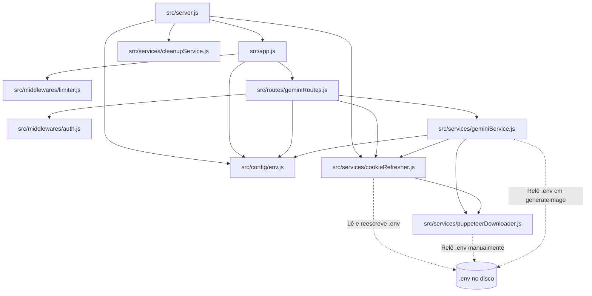

# Relatório de Auditoria Técnica e Plano de Refatoração

**Projeto:** `gemini-custom-api` (Open Gemini API)  
**Escopo:** Auditoria de arquitetura, código limpo, modularização, padronização e segurança para publicação open source no GitHub  
**Restrição principal:** Preservação integral do comportamento funcional, rotas, contratos HTTP e formatos de resposta atuais.

---

## 1. Resumo da Arquitetura Atual

A aplicação é uma API REST em **Node.js (ES Modules, `>=18.0.0`)** construída sobre **Express 4**, projetada para expor funcionalidades da interface web do Google Gemini (via `gemini-web-sdk` autenticado por cookies de sessão) e síntese neural de voz gratuita da Microsoft (via `msedge-tts`), com suporte complementar do **Puppeteer Core** (usando instalação local do Google Chrome/Chromium) para renovação automática de cookies e download autenticado de imagens/vídeos em alta resolução.

Não há banco de dados relacional ou NoSQL. Toda a persistência ocorre diretamente no sistema de arquivos local:
- `storage/media/`: armazenamento temporário de mídias geradas (`.mp3`, `.mp4`, `.jpg`, `.png`), servidas estaticamente e limpas por TTL (padrão de 4h).
- `storage/chrome-profile/`: perfil persistente (`userDataDir`) do navegador Chromium usado para manter a sessão Google ativa.
- `.env`: utilizado simultaneamente como arquivo de configuração estática e como armazenamento mutável em tempo de execução para cookies e tokens anti-CSRF renovados.

### Inventário Atual do Projeto (20 arquivos, ~4.151 linhas)

| Caminho | Linhas | Papel Atual |
|---|---:|---|
| `package.json` | 41 | Metadados, scripts (`start`, `dev`, `test`, `login`, `refresh-cookies`, `clean-profile`) e 8 dependências |
| `.env.example` | 56 | Template de variáveis de ambiente |
| `.gitignore` | 26 | Regras de exclusão do Git |
| `README.md` | 419 | Documentação geral, exemplos cURL, deploy Nginx/VPS/PM2 |
| `REQUISICOES.md` | 683 | Guia estendido de requisições (cURL, PowerShell, JS, Python, n8n) |
| `requests.http` | 110 | Coleção executável para extensões REST Client / Thunder Client |
| `src/server.js` | 68 | Bootstrap HTTP, criação de `storage/media`, inicialização de timers e graceful shutdown |
| `src/app.js` | 120 | Instância Express, Helmet, CORS, parsers JSON, arquivos estáticos, rate limit, rotas e 404/500 |
| `src/config/env.js` | 91 | Leitura inicial do `.env` via `dotenv` e exportação congelada (`Object.freeze`) |
| `src/middlewares/auth.js` | 74 | Autenticação por API Key (`x-api-key` ou `Bearer`) usando SHA-256 + `crypto.timingSafeEqual` |
| `src/middlewares/limiter.js` | 34 | Rate limiting por IP (`express-rate-limit`, 100 req / 15 min) |
| `src/routes/geminiRoutes.js` | 507 | Todas as 10 rotas HTTP, validação inline, catálogo de vozes, streaming de mídia e erro |
| `src/services/geminiService.js` | 1.424 | "God Service": cliente Gemini, cache de token, Edge TTS completo, texto, imagem, vídeo, áudio e research |
| `src/services/cookieRefresher.js` | 456 | Automação Puppeteer para login/renovação de cookies, cron interno e leitura/escrita direta no `.env` |
| `src/services/puppeteerDownloader.js` | 367 | Localização de binário Chrome/Chromium e download autenticado de mídias do Google CDN |
| `src/services/cleanupService.js` | 105 | Exclusão periódica de arquivos expirados em `storage/media` |
| `scripts/login-gemini.js` | 42 | CLI interativa (`headless: false`) para login inicial na conta Google |
| `scripts/refresh-cookies.js` | 24 | CLI silenciosa (`headless: true`) para teste manual de renovação de cookies |
| `test/api.test.js` | 104 | Smoke test HTTP básico (6 verificações sequenciais com `fetch`) |
| `storage/media/.gitkeep` | 1 | Preservação do diretório de mídias vazio |

### Fluxo Atual de Dependências Internas



---

## 2. Problemas Encontrados

### 2.1. Bugs Funcionais Latentes no Código Atual

1. **`ReferenceError` em rota ativa (`src/routes/geminiRoutes.js`, linhas 14 e 483):**
   - A rota `POST /refresh-cookies` chama `isCookieRefreshRunning()` na linha 483, mas a função **não foi importada** na linha 14 (`import { renovarCookiesGemini } from '../services/cookieRefresher.js'`). Qualquer requisição autenticada para `/api2/refresh-cookies` falha imediatamente com erro `500` (`isCookieRefreshRunning is not defined`).
2. **Falso positivo de sucesso na renovação de cookies (`src/services/cookieRefresher.js`, linhas 335–338 vs. `src/routes/geminiRoutes.js`, linhas 84–91 e 490–497):**
   - Quando a sessão expira em modo headless, `renovarCookiesGemini()` retorna `{ sucesso: false, mensagem: '...' }` em vez de lançar erro. Porém, as rotas `/renew-cookies`, `/refresh-cookies` e o cron (`cookieRefresher.js:427-428`) assumem sucesso se nenhuma exceção for lançada, respondendo HTTP `200` com `"Cookies renovados com sucesso!"` mesmo quando a renovação falhou.
3. **Rate Limiting contabilizado em dobro para rotas `/api2/*` (`src/app.js`, linhas 72–73):**
   - A mesma instância `apiLimiter` é montada sequencialmente em `app.use('/api2', apiLimiter)` e `app.use('/', apiLimiter)` antes das rotas. Toda requisição enviada a `/api2/*` atravessa ambos os middlewares e consome **2 fichas por chamada**, reduzindo na prática o limite anunciado de 100 req/15min para **50 req/15min** em `/api2/*`.
4. **Inconsistência de autenticação em `deepResearch` (`src/services/geminiService.js`, linha 1399):**
   - Enquanto `generateText`, `generateVideo`, `generateImage` e `generateAudio` utilizam `await getAuthenticatedGeminiClient()` (que valida e auto-renova `accessToken`), `deepResearch()` chama `getGeminiClient()` síncrono, falhando caso o cliente ainda não tenha sido inicializado ou os tokens tenham expirado.

### 2.2. Duplicação de Código e Responsabilidades Semelhantes

1. **Três leitores/parsers manuais distintos do arquivo `.env`:**
   - `src/services/cookieRefresher.js` (`lerCookiesDoEnv`, linhas 43–57).
   - `src/services/puppeteerDownloader.js` (`getGoogleCookies`, linhas 99–118 — criado com o comentário explícito de contornar dependência circular com `geminiService.js`).
   - `src/services/geminiService.js` (dentro do loop de `generateImage`, linhas 1068–1077 — lê o `.env` do disco sincronamente a cada imagem gerada, ignorando o objeto `runtimeCookies` já mantido em memória na linha 43 do próprio arquivo).
2. **Duas rotas com o mesmo propósito de renovar cookies (`src/routes/geminiRoutes.js`):**
   - `POST /renew-cookies` (linhas 81–96, desprotegida) e `POST /refresh-cookies` (linhas 481–505, protegida por `authMiddleware`, porém quebrada por falta de import).
3. **Criação repetida do diretório de mídias em 3 módulos:**
   - `src/server.js` (linhas 14–22), `src/services/geminiService.js` (`ensureStorageDirectory`, linhas 34–38) e `src/services/puppeteerDownloader.js` (linhas 346–349).
4. **Detecção do modo calmo/sono repetida 3 vezes (`src/services/geminiService.js`):**
   - Mesma cadeia de comparações (`modo === 'sono' || modo === 'dormir' || ...`) repetida nas linhas 511–518 (`prepareSSMLText`), 588–594 (`synthesizeEdgeNeural`) e 1211–1219 (`generateAudio`).
5. **Detecção regex de recusas de IA repetida 3 vezes (`src/services/geminiService.js`):**
   - Expressões regulares sobrepostas nas linhas 579 (`synthesizeEdgeNeural`), 748 e 758 (`generateText`).
6. **Lógica duplicada de download/variantes de URL de imagens do Google CDN:**
   - Manipulação de sufixos `=s0`, `=w2048`, `=s2048-rj` e `fetch` com `User-Agent`/`Referer` espalhada em `src/routes/geminiRoutes.js` (linhas 299–334), `src/services/geminiService.js` (linhas 1055–1115) e `src/services/puppeteerDownloader.js` (linhas 178–208).
7. **Validação repetitiva de parâmetros obrigatórios e flag de stream (`src/routes/geminiRoutes.js`):**
   - Checagem `!prompt || typeof prompt !== 'string' || prompt.trim() === ''` repetida 4 vezes (linhas 186, 226, 269, 452) e detecção `querStream` repetida em `/generate-image` (linhas 281–285) e `/generate-audio` (linhas 415–419).
8. **Resolução de modelo inconsistente (`src/services/geminiService.js`):**
   - `resolveModel()` (linhas 691–715) é usada em `generateText` e `generateVideo`, mas `generateImage` (linhas 996–1005) reimplementa manualmente `Model.fromName(opcoes.model)`.

### 2.3. Código Morto, Imports e Parâmetros Não Utilizados

1. **`GEMINI_API_KEY` (variável morta):** declarada em `.env.example` (linha 20) e `src/config/env.js` (linha 59), porém **jamais referenciada** em nenhum módulo do projeto.
2. **`getRuntimeCookies()` (`src/services/geminiService.js`, linhas 60–62):** função exportada, mas nunca importada em nenhum arquivo nem incluída no `export default`.
3. **Import não utilizado (`src/services/geminiService.js`, linha 22):** `GeminiError` é desestruturado de `gemini-web-sdk` e nunca referenciado; além disso, há um `import` deslocado na linha 40 (no meio do código executável).
4. **Parâmetros e variáveis locais sem efeito:**
   - `src/routes/geminiRoutes.js` (linhas 224, 239–240): `durationSeconds` e `aspectRatio` são repassados a `geminiService.generateVideo()`, que os ignora completamente.
   - `src/routes/geminiRoutes.js` (linhas 376–384): `provedor`, `modo`, `voice`, `voiceId`, `rate`, `pitch`, `stability`, `similarity_boost`, `style` são desestruturados em `/generate-audio` sem uso local; e `provedor`, `voiceId`, `stability`, `similarity_boost`, `style` tampouco têm qualquer efeito em `geminiService.generateAudio()` (resquício de integração antiga com ElevenLabs).
   - `src/services/geminiService.js`: parâmetro `isDark = false` ignorado em `normalizePitch` (linha 382) e `normalizeRate` (linha 407); variável `fullSizeOk` atribuída e nunca lida em `generateImage` (linhas 1037, 1044); `pauseParagrafo` copiado em `opcoesSintese` (linha 1257) mas ignorado por `prepareSSMLText()` (assim como `pauseVirgula` documentado no `README.md:227`).
   - `src/services/puppeteerDownloader.js` (linha 162): `const timeout = options.timeout || 45000;` declarada e nunca utilizada.

### 2.4. Mistura de Responsabilidades e Arquitetura

1. **Monolito em `src/services/geminiService.js` (1.424 linhas):** combina em um único arquivo gerenciamento de estado de autenticação do Gemini, todo o subsistema Microsoft Edge TTS (~420 linhas sem relação com o Gemini), regras opinativas de prompt engineering ("Canais Dark / Black Ops" e reescrita silenciosa de palavras bloqueadas para `"pesquisa histórica"` na linha 725), download de mídias via HTTP/RPC privado (`_getFullSizeImage`) e formatação de erros HTTP (`formatGeminiError`).
2. **Ausência de separação entre rotas e controllers (`src/routes/geminiRoutes.js`, 507 linhas):** a rota `POST /generate-image` executa I/O síncrono de arquivos (`fs.existsSync`, `fs.writeFileSync`) e chamadas HTTP externas (`fetch` para `googleusercontent.com`) diretamente dentro do callback da rota Express.
3. **Configurações espalhadas fora de `src/config/env.js`:**
   - `puppeteerDownloader.js` lê `process.env.PUPPETEER_EXECUTABLE_PATH`, `CHROME_BIN`, `CHROME_PATH`, `LOCALAPPDATA`, `HOME`, `USERPROFILE` diretamente.
   - Intervalo de auto-renovação de cookies divergente em 3 lugares: `server.js:28` fixa `3` horas, `cookieRefresher.js:416` define default de `12` horas, e `REQUISICOES.md:659` documenta `8` horas.
   - Caminho `./storage/chrome-profile` hardcoded tanto em `cookieRefresher.js:14` quanto no script inline `clean-profile` de `package.json:13`.
   - Limites de rate limit (`15 min`, `100 req`), tamanho de body (`10mb`), TTL de cache de token (`15 min`), intervalo de limpeza (`30 min`) e strings de `User-Agent` (Chrome 133 em três arquivos vs. Chrome 126 em `cookieRefresher.js:196`) espalhados como constantes mágicas.

### 2.5. Padronização, Nomenclatura e Tratamento de Erros (Fase 4)

1. **Mistura de idiomas nos identificadores internos:** coexistência de nomes em português e inglês no mesmo módulo — ex.: `renovarCookiesGemini`, `lerCookiesDoEnv` e `salvarCookiesNoEnv` ao lado de `startCookieAutoRefreshTask`, `isCookieRefreshRunning` e `onCookiesUpdated` (`cookieRefresher.js`); `opcoesOuIsCalm`, `sucessoBloco`, `querStream` e `bufferRecebido` ao lado de `receivedToken`, `writeStream` e `rawUrls`. *(Nota: as chaves JSON das respostas HTTP permanecerão em português para não quebrar contratos existentes).*
2. **Tratamento de erros fragmentado:**
   - `src/app.js` possui um middleware global de erro (linhas 107–118), mas nenhuma rota delega erros via `next(err)`.
   - Rotas de sessão (`/session-status`, `/renew-cookies`, `/refresh-cookies`) e o fallback de `formatGeminiError` (`geminiService.js:247`) expõem `error.message` bruto ao cliente mesmo quando `NODE_ENV=production`, contradizendo a política de `src/app.js:113`.
   - 16 blocos `catch (_) {}` silenciosos espalhados pelo código dificultam depuração de falhas de rede/permissão.
3. **Ausência de ferramentas de padronização e reprodutibilidade:** não há `.editorconfig`, configuração de lint/formatação, nem `package-lock.json` (atualmente ignorado no `.gitignore`).

---

## 3. Arquivos que Podem Ser Removidos (com Justificativa)

Após rastrear todos os imports estáticos, scripts do `package.json`, referências de documentação e rotinas agendadas:

- **Arquivos JavaScript (`.js`):** **Nenhum arquivo `.js` deve ser removido.** Todos os 13 arquivos `.js` (`src/`, `scripts/` e `test/`) estão efetivamente integrados na execução do servidor, nos comandos `npm run login` / `npm run refresh-cookies` ou em `npm test`.
- **Arquivos de documentação/apoio na raiz (consolidação e realocação, não descarte de conteúdo):**
  - `REQUISICOES.md` (raiz) → **Mover para `docs/API_REFERENCE.md`** e remover de `README.md` a duplicação extensa de payloads, mantendo o `README.md` enxuto com visão geral, quickstart e link para `docs/API_REFERENCE.md`. Justificativa: hoje há ~60% de conteúdo repetido entre os dois arquivos na raiz, gerando divergências de manutenção.
  - `requests.http` (raiz) → **Mover para `docs/requests.http`** (ou `examples/requests.http`), substituindo a chave e o domínio de teste do autor por placeholders genéricos. Justificativa: limpa a raiz do repositório open source preservando a utilidade para usuários de VS Code REST Client.

---

## 4. Arquivos que Precisam Ser Reorganizados

| Arquivo Atual | Ação Recomendada | Motivo |
|---|---|---|
| `src/services/geminiService.js` (1.424 linhas) | **Fatiar em módulos coesos** (`services/gemini/*` e `services/tts/*`) | Elimina o "God Service", separa Gemini Web SDK de Microsoft Edge TTS e isola funções puras testáveis |
| `src/routes/geminiRoutes.js` (507 linhas) | **Separar rotas por domínio + extrair controllers e catálogo** (`routes/*`, `controllers/*`, `config/voicesCatalog.js`) | Retira 70 linhas de JSON estático e 65 linhas de streaming/fetch/FS de dentro do roteador Express |
| `src/services/cookieRefresher.js` (456 linhas) | **Mover para `src/services/browser/cookieRefresherService.js`** + extrair persistência de sessão para `sessionStore.js` | Centraliza leitura/escrita de credenciais em um único ponto e remove chave hardcoded |
| `src/services/puppeteerDownloader.js` (367 linhas) | **Dividir em `chromeLocator.js` e `mediaDownloaderService.js`** em `src/services/browser/` | Desacopla localização de binário multiplataforma da lógica de download e consome `sessionStore` em memória |
| `src/services/cleanupService.js` (105 linhas) | **Mover para `src/services/storage/mediaCleanupService.js`** (incluindo `ensureStorageDir`) | Unifica as 3 rotinas duplicadas de garantia de diretório e limpeza por TTL |
| `src/middlewares/auth.js` e `limiter.js` | **Padronizar nomes** (`authMiddleware.js`, `rateLimiter.js`) e tornar limites configuráveis via `env.js` | Consistência de nomenclatura e configuração |
| `src/config/env.js` | **Expandir centralização** (incluir variáveis de Chrome, CORS, Rate Limit e intervalo de cookies; remover `GEMINI_API_KEY` morta) | Elimina acessos espalhados a `process.env` no restante do código |
| `REQUISICOES.md` e `requests.http` | **Mover para `docs/`** e sanitizar URLs/chaves | Organização limpa da raiz para contribuidores no GitHub |

---

## 5. Funções que Precisam Ser Divididas

1. **`renovarCookiesGemini()` (`src/services/cookieRefresher.js`, linhas 111–409 — 299 linhas):**
   - *Problemas:* Gerencia lock concorrente (`while (isRefreshing)`), configura X11 `DISPLAY`/`XAUTHORITY` no Linux, lança Puppeteer, injeta cookies semente, executa loop de espera/recuperação CDP de `CookieMismatch`, extrai tokens `WIZ_global_data`, grava `.env` e dispara callback.
   - *Divisão proposta:* `configureLinuxDisplay()`, `buildSeedCookies()`, `waitForAuthenticatedGeminiPage(page, options)`, `extractSessionTokens(page)` e delegação de persistência ao `sessionStore`. Unificar o contrato de erro (lançar `AppError` ou retornar resultado tipado consistente sem falsos HTTP 200).
2. **`generateAudio()` (`src/services/geminiService.js`, linhas 1183–1392 — 210 linhas):**
   - *Problemas:* Faz sobrecarga de parâmetros (`string | object`), detecta estilo por regex, calcula modulação, sintetiza TTS direto, constrói prompt de "canal dark", chama Gemini, salva MusicFX e sintetiza TTS pós-Gemini.
   - *Divisão proposta:* `resolveAudioStyleProfile(options, textSample)`, `synthesizeDirectScript(...)`, `generateMusicMedia(...)` e `generateNarratedStory(...)`.
3. **`downloadGoogleMedia()` (`src/services/puppeteerDownloader.js`, linhas 161–366 — 206 linhas):**
   - *Problemas:* Monta permutações de URLs CDN, instancia navegador, injeta sessão, avalia resoluções via DOM (`Image`/`Blob`) no `page.evaluate`, executa fallback sequencial `page.goto` e persiste em disco.
   - *Divisão proposta:* `buildHighResCandidateUrls(urls)` (função pura testável!), `fetchBestCandidateInPage(page, urls)`, `fetchCandidateByNavigation(page, urls)` e `downloadGoogleMedia()`.
4. **`generateImage()` (`src/services/geminiService.js`, linhas 989–1171 — 183 linhas):**
   - *Problemas:* Monta prompt, chama RPC privado `_getFullSizeImage`, lê `.env` do disco em loop, faz tentativa HTTP direta, fallback Puppeteer e fallback `imgObj.save()`.
   - *Divisão proposta:* `buildImagePrompt(prompt, aspectRatio)`, `resolveFullSizeImageUrl(imgObj)`, `saveGeneratedImage(imgObj, urls, cookieHeader)` (reutilizando helper compartilhado de download).
5. **`generateVideo()` (`src/services/geminiService.js`, linhas 860–978 — 119 linhas):**
   - *Problemas:* Prepara arquivo de referência, faz fallback de modelo/chat, classifica erros por regex na resposta textual e encadeia 2 estratégias de download de vídeo + thumbnail.
   - *Divisão proposta:* Validar com segurança a imagem de entrada (`prepareReferenceImage`), `requestVideoGeneration(client, prompt, files, model)` e `persistGeneratedVideo(videoObj, baseUrl)`.
6. **`synthesizeEdgeNeural()` (`src/services/geminiService.js`, linhas 570–682 — 113 linhas):**
   - *Problemas:* Valida texto/recusa, normaliza parâmetros, divide chunks, controla `WriteStream`, gerencia ciclo de vida e retries do WebSocket `MsEdgeTTS` e remove arquivo corrompido em falha.
   - *Divisão proposta:* Isolar em `edgeTtsService.js`, separando `streamChunkWithRetry(ttsState, chunkText, prosody)` da orquestração do arquivo de saída.
7. **Callback da rota `POST /generate-image` (`src/routes/geminiRoutes.js`, linhas 265–361 — 97 linhas):**
   - *Problemas:* Contém 65 linhas de streaming binário, leitura/escrita em disco e `fetch` externo para servidores Google.
   - *Divisão proposta:* Mover a obtenção do buffer/arquivo de imagem para `imageService` (`resolveImageBinaryForStream(imagem)`), deixando o controller apenas definir headers HTTP e enviar `res.sendFile` / `res.send`.

---

## 6. Comentários que Podem Ser Removidos vs. Preservados (Fase 2)

### 6.1. Comentários a Remover

1. **Blocos JSDoc de topo `@file` / `@description` gerados automaticamente nos 13 arquivos `.js`:**
   - `src/server.js:1-5`, `src/app.js:1-5`, `src/config/env.js:1-6`, `src/middlewares/auth.js:1-7`, `src/middlewares/limiter.js:1-6`, `src/routes/geminiRoutes.js:1-6`, `src/services/geminiService.js:1-6`, `src/services/cleanupService.js:1-5`, `src/services/puppeteerDownloader.js:1-5`, `src/services/cookieRefresher.js:1-6`, `scripts/login-gemini.js:1-5`, `scripts/refresh-cookies.js:1-5`, `test/api.test.js:1-5`.
2. **Divisórias decorativas excessivas (`// ====...====`):**
   - `src/app.js` (8 blocos ao longo de 120 linhas) e `src/services/geminiService.js` (linhas 1221–1223, 1260–1262, 1296–1298).
3. **Comentários que apenas repetem código óbvio ou resíduos de sessões de IA:**
   - `src/server.js:30` (`// Inicia a escuta na porta especificada`).
   - `src/config/env.js:15, 48, 52, 78, 87` (comentários narrando cada chave óbvia do objeto `config`).
   - `src/middlewares/auth.js:34, 62` (`// 2. Se nenhuma chave foi enviada...`, `// Autenticação bem-sucedida...`).
   - `src/middlewares/limiter.js:14-17, 20` (repetição literal dos nomes das opções `windowMs`, `max`, `standardHeaders`).
   - `src/services/geminiService.js:28, 32, 764` (incluindo `// ← FIX: reseta flag para que o texto seja retornado`), `:937`.
   - `src/services/cookieRefresher.js:23–36, 384, 387` e `src/services/puppeteerDownloader.js:345`.
4. **Comentários desatualizados/enganosos que contradizem o comportamento real (devem ser removidos ou corrigidos):**
   - `.env.example:16-19` e `src/config/env.js:58` (afirmam uso de `GEMINI_API_KEY` para Imagen 3 e Veo 2, o que não existe no código).
   - `src/routes/geminiRoutes.js:170` e `README.md:212` (afirmam injeção de tags `<break time='...'>`, quando `prepareSSMLText` na verdade remove `<break>` para evitar desconexão do Edge TTS).
   - `src/services/geminiService.js:57` (afirma uso de `getRuntimeCookies` pelo `puppeteerDownloader`, o que não ocorre).
   - `src/services/cookieRefresher.js:412` vs `src/server.js:27` vs `REQUISICOES.md:659` (divergência entre 12h, 3h e 8h).

### 6.2. Comentários Técnicos de Alto Valor que DEVEM Ser Preservados

- **`src/middlewares/auth.js:44-47`:** explica o requisito criptográfico de aplicar SHA-256 antes de `crypto.timingSafeEqual` para fixar ambos os buffers em 32 bytes, evitando `RangeError` e vazamento de tamanho da chave por timing.
- **`src/config/env.js:12`:** explica o motivo de `dotenv.config({ override: true })` em restarts sob PM2.
- **`src/app.js:28-30, 54, 77-79`:** justifica `crossOriginResourcePolicy: 'cross-origin'` para reprodução de mídia em players externos e o suporte simultâneo a `/api2` e `/` atrás de diferentes configurações de `proxy_pass` no Nginx.
- **`src/services/cookieRefresher.js:216-218, 334`:** documenta o erro `CookieMismatch` do Google caso cookies sejam injetados simultaneamente em `.google.com` e `.gemini.google.com`, e a proteção contra sobrescrita destrutiva do `.env` quando a sessão headless expira.
- **`src/services/geminiService.js:316-318, 380, 494-496, 597`:** documenta limitações reais não óbvias do WebSocket Microsoft Edge Read Aloud (fechamento abrupto da conexão com vozes exclusivas do Azure pago, valores absolutos inválidos de pitch, rejeição de tags `<break>` e erro HTTP 403 do Bing em múltiplas conexões curtas).
- **`src/services/geminiService.js:729-730, 865, 1035`:** documenta comportamentos internos do `gemini-web-sdk` (falha `1097` em `Model.UNSPECIFIED`, necessidade de `extended_thinking: false` para geração de vídeo Veo e chamada RPC `_getFullSizeImage` para superar thumbs de 512px).
- **`src/services/cleanupService.js:94` e `src/services/cookieRefresher.js:445`:** explica o uso de `timer.unref()` para não travar o encerramento do processo Node.js.

---

## 7. Problemas de Segurança e Prontidão Open Source (Fase 5)

### 7.1. Vulnerabilidades e Exposição de Dados Sensíveis

1. **[CRÍTICO] Chave secreta hardcoded no código-fonte (`src/services/cookieRefresher.js`, linha 73):**
   - Na função `salvarCookiesNoEnv()`, o bloco `else` (acionado caso nem `.env` nem `.env.example` existam) define uma string literal contendo um valor de `API_SECRET_KEY` de alta entropia (51 caracteres, aparentando ser credencial real de ambiente do autor) e a URL privada de produção. *(Valor omitido deste relatório por segurança).*
   - **Ação obrigatória antes de publicar no GitHub:** remover imediatamente o segredo literal do código, invalidar/rotacionar essa chave caso esteja ativa em algum servidor VPS, e inicializar o histórico Git apenas após a remoção (evitando que o segredo fique gravado em commits anteriores).
2. **[CRÍTICO] Endpoints de sessão e renovação de cookies expostos SEM autenticação (`src/routes/geminiRoutes.js`, linhas 61–96):**
   - `GET /api2/session-status` (linha 61) não possui `authMiddleware`: expõe publicamente os primeiros 12 caracteres do token anti-CSRF (`SNlM0e`) da conta Google (`accessTokenParcial`), `buildLabel` e aciona `getAuthenticatedGeminiClient()`.
   - `POST /api2/renew-cookies` (linha 81) não possui `authMiddleware`: permite que qualquer usuário anônimo dispare instâncias headless do Google Chrome no servidor (vetor direto de **Negação de Serviço / exaustão de RAM e CPU**), force escrita no `.env` e receba `accessTokenParcial`.
3. **[ALTO] Chave padrão previsível permitida em produção (`src/config/env.js`, linhas 21–27 e 56):**
   - Se `API_SECRET_KEY` não estiver definida no `.env`, o servidor sobe normalmente até mesmo com `NODE_ENV=production` utilizando a chave fixa `'chave_padrao_desenvolvimento_local_alef_2026'`. Em produção, a ausência de `API_SECRET_KEY` (ou o valor placeholder `'sua_chave_secreta_aqui'`) deve abortar a inicialização (`process.exit(1)`).
4. **[ALTO] Leitura Arbitrária de Arquivos Locais (LFI) e SSRF em `prepareImageFile()` (`src/services/geminiService.js`, linhas 816–838):**
   - Na rota `POST /generate-video`, o campo `req.body.image` / `imageUrl` é passado para `prepareImageFile(imageInput)`:
     - Linhas 820–822: `if (fs.existsSync(str)) return { path: str, isTemp: false };` permite que um cliente autenticado informe qualquer caminho de arquivo local do servidor (ex.: `.env`, `/etc/passwd`, chaves SSH) para ser enviado como upload ao chat externo do Gemini.
     - Linhas 830–838: `fetch(str)` aceita qualquer URL `http://` ou `https://` sem bloqueio de IPs privados/loopback/link-local (`127.0.0.1`, `169.254.169.254`, `10.0.0.0/8`, `192.168.0.0/16`) e sem limite de tamanho ou validação de `Content-Type: image/*`.
5. **[MÉDIO] Logs expondo prefixos de cookies e tokens de sessão Google:**
   - `src/services/cookieRefresher.js:378-382` loga os primeiros 16 caracteres de `__Secure-1PSID`, `__Secure-1PSIDTS` e `SNlM0e`; `scripts/refresh-cookies.js:19` loga 20 caracteres de `__Secure-1PSIDTS`; `src/services/geminiService.js:148, 178` loga 12 caracteres de `accessToken`. Logs devem indicar apenas presença/status booleano sem imprimir partes de credenciais de sessão.
6. **[MÉDIO] Domínio privado de produção e identificadores de teste espalhados:**
   - O domínio `apibackend.win` aparece em `.env.example:36,38`, `src/services/cookieRefresher.js:73`, `src/routes/geminiRoutes.js:21`, `requests.http:9`, `README.md` e `REQUISICOES.md`. Deve ser substituído por domínio fictício padrão (`https://api.example.com/api2`) para não expor a infraestrutura real do mantenedor.
   - A chave de exemplo `secret-test-key-2026-alef-santos` em `README.md` e `requests.http` deve ser trocada pelo placeholder `sua_chave_secreta_aqui`.
7. **[MÉDIO] CORS com `origin: '*'` combinado a `credentials: true` (`src/app.js`, linhas 36–41):**
   - Deve suportar restrição opcional por variável `CORS_ORIGIN` (mantendo `'*'` como default para não quebrar integrações atuais, mas com `credentials: false` quando `origin === '*'`).

### 7.2. Checklist de Governança e Documentação Open Source

| Item | Status Atual | Diagnóstico e Recomendação |
|---|---|---|
| Repositório `.git` / `.env` versionado | Não há `.git` nem `.env` no disco | Excelente momento para sanitizar os segredos **antes** do `git init`, garantindo histórico limpo desde o primeiro commit. |
| `.gitignore` | Parcialmente adequado | Cobre `.env*`, `node_modules/`, `storage/media/*` e `storage/chrome-profile/`. **Problema:** ignora `package-lock.json` (linha 3), o que prejudica builds determinísticos. Adicionar `coverage/` e `*.log`, e remover `package-lock.json` do `.gitignore`. |
| `.env.example` | Presente, precisa ajustes | Não contém segredos reais, mas traz `BASE_URL=https://apibackend.win/api2` (deve ser `http://localhost:3333/api2`), inclui `GEMINI_API_KEY` morta e omite `PUPPETEER_EXECUTABLE_PATH` e `COOKIE_REFRESH_HOURS`. |
| `LICENSE` | **Ausente** | `package.json` declara `"license": "MIT"` e `"author": "Alef Santos"`, mas não há arquivo `LICENSE` na raiz. Criar arquivo `LICENSE` padrão MIT (confirmando ano/autor do `package.json`). |
| `README.md` | Presente, desatualizado | Árvore de arquivos omite 6 arquivos reais; exemplos usam `apibackend.win`; omite `GET /voices`, `npm run login`, `npm run refresh-cookies`, `npm run clean-profile` e `npm test`; deve incluir aviso claro sobre uso de SDK web não-oficial. |
| Instruções de contribuição | **Ausentes** | Criar `CONTRIBUTING.md` enxuto (requisitos de ambiente, como rodar testes sem conta Gemini Pro, padrão de código e abertura de PRs/Issues). |

---

## 8. Dependências que Merecem Revisão

| Dependência | Versão (`package.json`) | Avaliação |
|---|---|---|
| `express` | `^4.21.2` | **Manter.** Estável, leve e amplamente conhecida. (Migrar para Express 5 mudaria semântica de rotas/async sem necessidade agora). |
| `helmet` | `^8.0.0` | **Manter.** Essencial para cabeçalhos HTTP seguros. |
| `cors` | `^2.8.5` | **Manter.** Utilizado diretamente em `src/app.js`. |
| `express-rate-limit` | `^7.5.0` | **Manter.** Proteção adequada; corrigir apenas a dupla montagem em `src/app.js`. |
| `dotenv` | `^16.4.7` | **Manter.** Necessário para compatibilidade com `node >= 18.0.0` e `override: true`. |
| `puppeteer-core` | `^25.11.0` | **Manter.** Decisão acertada frente ao `puppeteer` completo (evita download obrigatório de ~300 MB na instalação e usa o Chrome/Chromium do sistema). |
| `msedge-tts` | `^2.1.0` | **Manter com isolamento.** Usa o serviço WebSocket Read Aloud da Microsoft; isolá-lo em `src/services/tts/edgeTtsService.js` facilita substituição futura se o protocolo mudar. |
| `gemini-web-sdk` | `^2.3.0` | **Revisar acoplamento a membros privados.** O código atual acessa `client._ready`, `client._initPromise` (`geminiService.js:119,158-159`) e `imgObj.client_ref._getFullSizeImage` (`geminiService.js:1041`). Encapsular esses acessos em um único adaptador (`geminiClient.js` / `imageService.js`) com `try/catch` defensivo protege o restante do projeto contra atualizações internas do SDK. |

> **Nota sobre auditoria automatizada de CVEs (`npm audit`):** Nesta máquina de auditoria, a execução de comandos shell está bloqueada por Política de Grupo do Windows e `node_modules` / `package-lock.json` não estão instalados localmente. Antes da publicação, deve-se gerar o `package-lock.json` com `npm install` e executar `npm audit` em ambiente liberado/CI.  
> **Nota sobre testes e lint sem novas dependências:** O Node.js `>=18` já inclui nativamente `node:test` e `node:assert/strict` — permitindo criar toda a suíte de testes unitários e de integração **sem instalar Jest/Vitest/Supertest**. Caso deseje lint/formatação automatizada, recomenda-se adicionar apenas `eslint` (flat config) + `@eslint/js` como `devDependencies` opcionais, além de um `.editorconfig` zero-dependência.

---

## 9. Estrutura de Diretórios Recomendada

A arquitetura abaixo é **proporcional ao porte real do projeto** (~2.500 linhas de código efetivo após limpeza):
- **Não cria `models/` nem `repositories/`**, pois a aplicação não possui banco de dados.
- **Não introduz classes desnecessárias, containers de DI ou abstrações genéricas** — mantém funções e módulos ES claros e diretos.
- **Resolve a quase-dependência circular e as 3 releituras de `.env`** por meio de um único módulo `sessionStore.js`.

```text
open-gemini-api/
├── .editorconfig
├── .env.example
├── .gitignore
├── CONTRIBUTING.md
├── LICENSE
├── README.md
├── package.json
├── package-lock.json
├── docs/
│   ├── API_REFERENCE.md               # Antigo REQUISICOES.md revisado e sanitizado
│   ├── REFACTORING_AUDIT.md           # Este relatório de auditoria
│   └── requests.http                  # Antigo requests.http sanitizado
├── scripts/
│   ├── login-gemini.js
│   └── refresh-cookies.js
├── storage/
│   └── media/
│       └── .gitkeep
├── src/
│   ├── server.js                      # Inicialização HTTP, background tasks e graceful shutdown
│   ├── app.js                         # Express, Helmet, CORS, estáticos, montagem de rotas e errorHandler
│   ├── config/
│   │   ├── env.js                     # Validação e centralização de TODAS as variáveis de ambiente
│   │   └── voicesCatalog.js           # Catálogo estático, aliases e vozes oficiais do Edge TTS
│   ├── errors/
│   │   ├── AppError.js                # Classe simples de erro operacional (status, codigo, detalhes)
│   │   └── errorHandler.js            # formatGeminiError + middleware global Express padronizado
│   ├── middlewares/
│   │   ├── authMiddleware.js          # Autenticação timing-safe por API Key
│   │   └── rateLimiter.js             # Rate limiting sem dupla contagem
│   ├── routes/
│   │   ├── index.js                   # Roteador agregador montado em /api2 e /
│   │   ├── publicRoutes.js            # GET /health, GET /voices
│   │   ├── sessionRoutes.js           # GET /session-status, POST /refresh-cookies (e alias /renew-cookies) com authMiddleware
│   │   └── generationRoutes.js        # POST /generate-text, /generate-image, /generate-video, /generate-audio, /research
│   ├── controllers/
│   │   ├── sessionController.js       # Entrada/saída HTTP das rotas de sessão
│   │   └── generationController.js    # Entrada/saída HTTP e resposta binária (stream) das rotas de geração
│   ├── services/
│   │   ├── session/
│   │   │   └── sessionStore.js        # Fonte única em memória + leitura/atualização segura do .env
│   │   ├── browser/
│   │   │   ├── chromeLocator.js       # Detecção multiplataforma do Chrome/Chromium
│   │   │   ├── cookieRefresherService.js # Automação Puppeteer e agendamento periódico
│   │   │   └── mediaDownloaderService.js # Download autenticado de alta resolução (HTTP + Puppeteer)
│   │   ├── gemini/
│   │   │   ├── geminiClient.js        # Singleton do SDK, vínculo com sessionStore e resolveModel
│   │   │   ├── textService.js         # generateText e deepResearch
│   │   │   ├── imageService.js        # generateImage e obtenção de binário para stream
│   │   │   └── videoService.js        # generateVideo e validação segura de imagem de referência
│   │   ├── tts/
│   │   │   ├── ttsTextProcessor.js    # Funções puras: limpeza de texto, pseudo-SSML, chunking e prosódia
│   │   │   ├── edgeTtsService.js      # Streaming WebSocket com MsEdgeTTS e retry
│   │   │   └── audioService.js        # Orquestração generateAudio (roteiro direto, Gemini + TTS, MusicFX)
│   │   └── storage/
│   │       └── mediaCleanupService.js # ensureStorageDirectory + limpeza periódica por TTL
│   └── utils/
│       ├── requestUrl.js              # getRequestBaseUrl(req)
│       └── validators.js              # Validação enxuta de strings obrigatórias e flags de stream
└── test/
    ├── api.integration.test.js        # Contratos HTTP, autenticação, rate limit, erros e rotas de sessão
    ├── ttsTextProcessor.test.js       # Testes unitários de limpeza Markdown, SSML, vozes e chunking
    ├── validatorsAndErrors.test.js    # Testes unitários de validadores, requestUrl e mapeamento de erros
    └── mediaCleanup.test.js           # Testes unitários de expiração de arquivos temporários
```

---

## 10. Plano de Refatoração Dividido em Etapas

Cada etapa foi desenhada para ser **pequena, independente, verificável e reversível**, mantendo a aplicação 100% funcional ao final de cada passo:

### Etapa 1 — Correções Críticas de Segurança e Bugs Imediatos
1. Remover a `API_SECRET_KEY` e URL hardcoded de `src/services/cookieRefresher.js` (linha 73).
2. Exigir `API_SECRET_KEY` válida quando `NODE_ENV=production` em `src/config/env.js` (mantendo fallback seguro apenas em desenvolvimento/teste para não quebrar `npm test` local).
3. Proteger `GET /session-status` e `POST /renew-cookies` com `authMiddleware`, corrigir o import ausente de `isCookieRefreshRunning` em `/refresh-cookies`, tratar `{ sucesso: false }` de `renovarCookiesGemini()` para não retornar falso HTTP 200 e remover exposição desnecessária de prefixos de cookies/tokens em logs e respostas.
4. Bloquear leitura de caminhos locais arbitrários (`fs.existsSync(str)` em entradas do usuário) e URLs de rede interna/loopback (SSRF) em `prepareImageFile()`.
5. Corrigir a dupla montagem de `apiLimiter` em `src/app.js` (aplicando uma única vez para que o limite real seja de fato 100 req/15min) e corrigir `deepResearch()` para usar `await getAuthenticatedGeminiClient()`.

### Etapa 2 — Centralização de Configuração e Estado de Sessão (`config/` + `sessionStore`)
1. Consolidar em `src/config/env.js` todas as variáveis de ambiente (`PUPPETEER_EXECUTABLE_PATH`, `CHROME_BIN`, `CHROME_PATH`, `COOKIE_REFRESH_HOURS`, `CORS_ORIGIN`, `RATE_LIMIT_MAX`, `RATE_LIMIT_WINDOW_MS`), removendo a variável morta `GEMINI_API_KEY`.
2. Extrair `src/services/session/sessionStore.js` como fonte única das credenciais em memória e persistência no `.env`, eliminando os 3 leitores manuais duplicados de `.env`.
3. Extrair `src/config/voicesCatalog.js` unificando o catálogo da rota `GET /voices` e os mapas `EDGE_VOICE_ALIASES` / `EDGE_OFFICIAL_VOICES`.

### Etapa 3 — Padronização de Erros, Utilitários e Limpeza de Storage
1. Criar `src/errors/AppError.js` e `src/errors/errorHandler.js` (consolidando `formatGeminiError` e o middleware global de erro do Express, garantindo ocultação de mensagens internas sensíveis em `production` sem alterar `sucesso`, `mensagem` e `codigo` das respostas conhecidas).
2. Extrair `src/utils/requestUrl.js`, `src/utils/validators.js` e consolidar `ensureStorageDirectory` em `src/services/storage/mediaCleanupService.js`.

### Etapa 4 — Extração do Subsistema de Navegador (`services/browser/`) e TTS (`services/tts/`)
1. Dividir `puppeteerDownloader.js` e `cookieRefresher.js` em `chromeLocator.js`, `mediaDownloaderService.js` e `cookieRefresherService.js`, consumindo `sessionStore`.
2. Extrair de `geminiService.js` todas as funções puras de texto/voz para `src/services/tts/ttsTextProcessor.js`, a conexão WebSocket para `edgeTtsService.js` e a orquestração de áudio para `audioService.js`.

### Etapa 5 — Modularização do Domínio Gemini (`services/gemini/`) e Camada HTTP (`routes/` + `controllers/`)
1. Dividir o restante de `geminiService.js` em `geminiClient.js`, `textService.js`, `imageService.js` e `videoService.js`.
2. Extrair `sessionController.js` e `generationController.js` (movendo a lógica de streaming/download de `/generate-image` para `imageService.js`) e organizar as rotas em `publicRoutes.js`, `sessionRoutes.js`, `generationRoutes.js` e `routes/index.js` (mantendo todas as URLs idênticas em `/api2/*` e `/*`).

### Etapa 6 — Limpeza de Comentários, Padronização de Nomes e Suíte de Testes
1. Revisar comentários em todos os arquivos seguindo estritamente os critérios da Seção 6 (removendo cabeçalhos `@file` automáticos e comentários triviais/contraditórios; preservando comentários arquiteturais, de segurança e quirks do Edge TTS / Gemini SDK).
2. Padronizar identificadores internos em inglês (preservando 100% das chaves de request/response JSON em português).
3. Implementar a suíte automatizada com `node:test` (`test/*.test.js`).

### Etapa 7 — Preparação Final para Publicação Open Source
1. Sanitizar `.env.example`, `README.md`, `docs/API_REFERENCE.md` (antigo `REQUISICOES.md`) e `docs/requests.http` (removendo `apibackend.win` e chaves de teste nominais).
2. Ajustar `.gitignore` (permitindo `package-lock.json`), adicionar `.editorconfig`, `LICENSE` (MIT) e `CONTRIBUTING.md`.

---

## 11. Riscos de Cada Alteração e Mitigações

| Alteração | Nível de Risco | Impacto Potencial | Mitigação |
|---|---|---|---|
| **Exigir `authMiddleware` em `/session-status` e `/renew-cookies`** | **Médio** | Scripts externos ou monitoramentos que chamavam essas duas rotas sem `x-api-key` passarão a receber `401 MISSING_API_KEY`. | Manter `/health` 100% pública para monitoramento de uptime e documentar a exigência de chave nas rotas de sessão; manter `/renew-cookies` como alias autenticado de `/refresh-cookies` para não quebrar URLs antigas. |
| **Bloquear caminhos locais arbitrários em `prepareImageFile` (`/generate-video`)** | **Baixo / Médio** | Caso algum fluxo local no mesmo servidor envie caminho absoluto fora de `STORAGE_DIR` no campo `image`, será bloqueado. | Permitir URLs `https://` públicas, `data:image/...`, Base64 puro e, se necessário, apenas arquivos contidos estritamente dentro de `config.STORAGE_DIR` (validado com `path.resolve` contra traversal `..`). |
| **Exigir `API_SECRET_KEY` explícita em `NODE_ENV=production`** | **Médio** | Deploy em produção sem `API_SECRET_KEY` no `.env` recusará subir na inicialização. | Emitir mensagem de erro clara no boot explicando exatamente qual variável falta; manter fallback de desenvolvimento/teste quando `NODE_ENV !== 'production'`. |
| **Divisão de `geminiService.js` e criação do `sessionStore.js`** | **Médio** | Risco de dessincronização do singleton `clientInstance` quando os cookies forem renovados em background. | Manter invalidação automática da instância do cliente dentro do `sessionStore` (via listener ou controle de versão de credenciais) e cobrir com teste unitário. |
| **Extração do streaming de `/generate-image?stream=true`** | **Baixo** | Fluxos n8n dependem de `Content-Type: image/*` em sucesso e status `502` JSON (`STREAM_BINARY_UNAVAILABLE`) em falha binária. | Preservar exatamente os cabeçalhos `Content-Type`, `Content-Disposition` e o payload `502` atual, validando em teste de integração. |
| **Remoção do duplo `apiLimiter` em `src/app.js`** | **Baixo** | Aumenta o limite real de `/api2/*` de 50 de volta para os 100 req/15min documentados. | Comportamento passa a corresponder exatamente ao documentado no `README.md`. |
| **Comportamento opinativo em `generateText` (sanitização de termos e retry "documentário histórico")** | **Atenção (Decisão)** | Hoje `generateText` substitui certos termos por `'pesquisa histórica'` e refaz recusas com persona de documentarista. Remover isso alteraria o comportamento para fluxos atuais de canais dark; manter sem avisar pode surpreender usuários open source. | **Preservar o comportamento por padrão** (respeitando a regra de não alterar funcionalidades), isolando-o de forma legível e opcionalmente controlável por flag futura se você aprovar. |

---

## 12. Testes Necessários para Validar a Refatoração

Para garantir que nenhuma funcionalidade ou contrato HTTP foi quebrado, a validação será dividida em 3 camadas usando o test runner nativo do Node.js (`node --test`):

### 12.1. Testes Unitários (Rápidos, Sem Rede e Sem Conta Google)
1. **`test/ttsTextProcessor.test.js`:**
   - `cleanTextForTTS`: remoção de blocos de código, links Markdown, títulos, emojis, preservação de `\n\n` e expansão fonética (`R$ 10` → `10 reais`, `50%` → `50 por cento`, `80 km/h` → `80 quilômetros por hora`).
   - `prepareSSMLText`: escape de entidades XML (`&`, `<`, `>`), conversão de `<break>` para reticências/parágrafos conforme duração e modo calmo (`sono`, `meditacao`, `pausePonto`).
   - `splitTextIntoSafeChunks`: texto curto em chunk único (<=2500 chars), quebra por parágrafos e fallback por frases em parágrafos gigantes.
   - `resolveVoice`, `normalizePitch`, `normalizeRate`, `normalizeVolume`: aliases (`dark_mystery` → `pt-BR-AntonioNeural`, vozes pagas Azure → fallback Edge, limites de `-25%` a `+25%` em pitch e `-50%` a `+100%` em rate).
2. **`test/validatorsAndErrors.test.js`:**
   - `getRequestBaseUrl`: prioridade correta entre `x-forwarded-host`, `x-forwarded-proto`, `host` local vs. público e `config.BASE_URL`.
   - `formatGeminiError` / `AppError`: mapeamento exato de `AuthError` (`401 GEMINI_AUTH_EXPIRED`), `UsageLimitExceeded` (`429 GEMINI_USAGE_LIMIT`), `TemporarilyBlocked` (`403 GEMINI_IP_BLOCKED`), `ModelInvalid` (`400 GEMINI_INVALID_MODEL`), `APIError` (`502 GEMINI_API_ERROR`) e ocultação de `err.message` interno em modo produção.
   - `prepareReferenceImage`: bloqueio de Path Traversal (`/etc/passwd`, `../../.env`) e SSRF (`http://127.0.0.1`, `http://169.254.169.254`), aceitando Base64 e `data:image/png;base64,...`.
3. **`test/mediaCleanup.test.js`:**
   - Criação de pasta temporária isolada (`os.tmpdir()`), verificação de que arquivos mais velhos que `maxAgeMs` são removidos, arquivos recentes permanecem e `.gitkeep` é preservado.
4. **`test/sessionStore.test.js`:**
   - Atualização de credenciais em memória invalida o cliente cacheado e persiste chaves em arquivo `.env` temporário de teste sem corromper outras variáveis.

### 12.2. Testes de Integração HTTP (`test/api.integration.test.js`)
Subindo `app` em porta efêmera (`app.listen(0)`) com serviços externos mockados/isolados:
- `GET /` e `GET /api2/health` e `GET /health` → `200` com contrato JSON intacto.
- `GET /api2/voices` → `200` com `padrao`, `vozesRecomendadasDark` e `outrasVozes`.
- Autenticação `authMiddleware`: sem chave (`401 MISSING_API_KEY`), chave incorreta (`401 INVALID_API_KEY`), chave válida via `x-api-key` e via `Authorization: Bearer <key>`, inclusive nas rotas `GET /api2/session-status`, `POST /api2/refresh-cookies` e `POST /api2/renew-cookies`.
- Validação `400` de contratos de entrada: `/generate-text` (`INVALID_PARAM_PROMPT`), `/generate-image` (`INVALID_PARAM_PROMPT`), `/generate-video` (`INVALID_PARAM_PROMPT`), `/generate-audio` (`INVALID_PARAM_AUDIO`), `/research` (`INVALID_PARAM_QUERY`).
- Rota inexistente → `404 ROUTE_NOT_FOUND`.
- Arquivos estáticos `/api2/media/:arquivo` e `/media/:arquivo` → cabeçalhos `Access-Control-Allow-Origin: *` e `Cross-Origin-Resource-Policy: cross-origin`.
- Rate limiting: confirmar que 1 requisição em `/api2/health` desconta exatamente `1` unidade no cabeçalho `RateLimit-Remaining` (e não `2`).

### 12.3. Smoke Test Manual Pré-Release (em Ambiente com Chrome e Credenciais)
1. `npm install && npm audit` (validar árvore de dependências e geração do `package-lock.json`).
2. `npm test` (executar 100% da suíte automatizada).
3. Com `.env` configurado: testar 1 chamada real de `POST /api2/generate-audio` (modo `text` direto via Edge TTS), `POST /api2/generate-text`, `POST /api2/generate-image` (JSON e `?stream=true`) e `GET /api2/session-status` autenticado.
